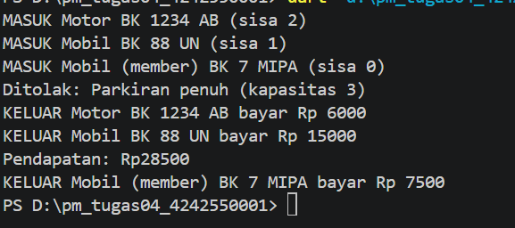

# Pemrograman Mobile - Tugas Rutin 4

Sistem parkir kampus berbasis console, dibuat dengan Dart. Kendaraan masuk dan
keluar lewat palang otomatis (disimulasikan dengan `Future.delayed`), biaya
dihitung per jam sesuai jenis kendaraan, dan setiap kejadian ditampilkan lewat
`Stream`.

## Identitas
- Nama  : Adinda Soleha
- NIM   : 4242550001
- Kelas : PSIK 24D
- Matakuliah: Pemrograman Mobile

## Cara Menjalankan
```
dart run bin/pm_tugas04_4242550001.dart
```

## Tarif
| Jenis | Tarif per jam |
|---|---|
| Motor | Rp2.000 |
| Mobil | Rp5.000 |
| Becak | Rp1.000 |
| Mobil (member) | Tarif Mobil dengan diskon 50% |

Biaya dibulatkan ke atas per jam, minimal 1 jam.

## Diagram Kelas


## Tangkapan Layar



## Penjelasan

Enkapsulasi saya terapkan pada kelas `Parkiran`. Data `_terparkir` dan
`_pendapatan` bersifat privat, hanya bisa dibaca lewat getter `sisa` dan
`pendapatan`, dan hanya berubah lewat method `masuk` dan `keluar`. Kelas ini
berada di berkas sendiri sehingga `main` tidak bisa mengubah datanya langsung.

Polimorfisme ada pada `Kendaraan`. Kelas abstrak ini punya satu method
`biaya()`, sedangkan `Motor`, `Mobil`, dan `Becak` menimpa getter
`tarifPerJam`, sehingga hasilnya menyesuaikan jenis kendaraan. Mixin
`Berlangganan` menimpa `biaya()` untuk diskon 50% pada `MobilMember`. Di
`main`, saya memasukkan berbagai jenis kendaraan ke satu `List<Kendaraan>`.

Async dipakai pada `masuk` dan `keluar`, yang mengembalikan `Future` dan
menunggu `Future.delayed` untuk mensimulasikan palang, lalu dipanggil dengan
`await` di `main`. Setiap kejadian dikirim lewat
`StreamController.broadcast()` dan ditampilkan oleh listener.

## Pernyataan Penggunaan AI

Saya menggunakan Claude sebagai alat bantu untuk menjelaskan
konsep (abstract class, mixin, `Future`/`await`, `Stream`), memberi kerangka
kode dengan bagian kosong yang saya lengkapi sendiri, dan membantu menemukan
kesalahan, misalnya angka diskon yang keliru, kelas `Mobil` yang belum dibuat,
dan baris kejadian yang dipanggil sebelum variabelnya dibuat. Kode saya tulis,
jalankan, dan uji sendiri. Draf README ini juga dibantu AI, lalu saya periksa
dan sesuaikan dengan kode saya.

Hal yang saya pelajari antara lain: getter abstrak dipakai agar subclass wajib
menyediakan nilainya, `await` harus berada di dalam `try` agar exception dari
`Future` tertangkap, dan listener pada stream broadcast harus dipasang sebelum
kejadian pertama dikirim.

## Dart Analyze
```
No issues found!

```